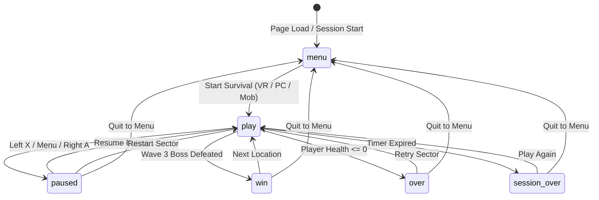
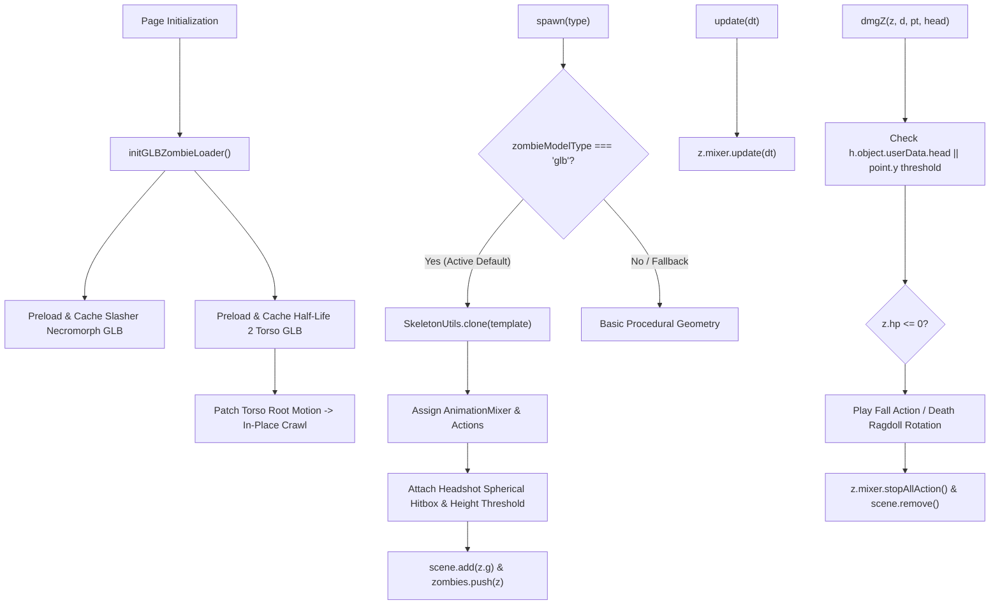

# DEAD ZONE: SURVIVAL APOCALYPSE — PROJECT BRAIN & ARCHITECTURE BLUEPRINT

> **Living Documentation & Memory Bank**  
> *Last Updated: November 18, 2026*  
> *Primary Target: Meta Quest 2 / Quest 3 / Quest Pro (Dedicated WebXR PWA Standalone) + PC FPS + Mobile Touch*  
> *Repository:* `https://github.com/pdvrgaming/zombie-shooting.git`  
> *Active Development Branch:* `vr`  
> *Production GitHub Pages Branch:* `main` (synced with `vr`)  
> *Live Deployment URL:* `https://pdvrgaming.github.io/zombie-shooting/`

---

## 1. Executive Summary & Purpose

**Dead Zone: Survival Apocalypse** is an immersive 3D WebXR survival horror first-person shooter engineered specifically for the **Meta Quest 2** VR headset (Snapdragon XR2) while maintaining responsive cross-platform support for PC keyboard/mouse and Mobile dual touch sticks.

This document serves as the **authoritative project brain** containing the complete architectural blueprint, memory map, controller schemes, state machines, sound matrix, and critical invariants. Any agent or developer working on this project must consult this document to avoid re-analyzing the 5,000+ line codebase.

---

## 2. File & Directory Structure

```text
e:\Zombie Shooting/
├── BRAIN.md                                # Authoritative Project Brain & Architectural Blueprint (This Document)
├── README.md                               # Public Repository Overview & Quest 2 Quickstart Guide
├── index.html                              # Complete Unified Game Application (~5,200 lines: HTML5, CSS3, Three.js, WebXR, Web Audio)
├── manifest.json                           # WebXR PWA Manifest (standalone, ovr_package_name, xr_targets: ["immersive-vr"])
├── sw.js                                   # Progressive Web App Service Worker (cache-first, offline fallback)
├── icon.png                                # 512×512 PWA Master Icon (maskable)
├── icon-192.png                            # 192×192 PWA Mobile/Quest Launcher Icon
├── Dead Zone Survival Apocalypse VR Storyboard.png  # Storyboard UI reference (8 panels)
├── Dead Zone_ Apocalypse at Dusk.png       # High-res concept art
├── bg-dusk.png                             # Dusk background texture
├── _backup/                                # Historical legacy backups
├── zombie characteres/                     # High-Definition 3D GLB Character Models (Option 2 Active)
│   ├── classic_zombie_torso__half-life_2.glb  # Half-Life 2 Torso Crawler (Valve Biped rig, 4.16MB)
│   └── zombie_monster_slasher_necromorph.glb  # Dead Space Slasher Necromorph (Mixamo rig, 4.97MB)
└── sounds/                                 # Spatial 3D Audio Library
    ├── Bite/                               # Zombie bite sound effects
    ├── Blood/                              # Blood splatter & gory impact sounds
    ├── BodyFall/                           # Ragdoll / body fall audio
    ├── Eat/                                # Flesh eating & biting audio
    ├── Foley/                              # Cloth movement & crawling foley
    ├── Footsteps/                          # Concrete footsteps for horde
    ├── Impact/                             # Bullet impact into flesh & concrete
    ├── pistol/                             # Dedicated Glock 17 gunfire (pi_hand_single_near_03.wav)
    ├── VO/                                 # Vocalizations
    │   ├── Zombie01/                       # Attack, Hurt, Idle audio variants
    │   └── Zombie03/                       # Attack, Hurt, Idle audio variants
    └── zombie sound/                       # Barrel explosions, debris, bite & attack assets
```

---

## 3. Technology Stack & Runtime Configuration

| Component | Specification | Notes |
|---|---|---|
| **Core 3D Engine** | Three.js r128 (via CDN) | Vanilla Three.js with zero external framework overhead |
| **VR Engine** | WebXR Device API | Session: `immersive-vr`, Features: `['local-floor', 'bounded-floor', 'hand-tracking']` |
| **Performance Target** | 72Hz / 90Hz on Meta Quest 2 | Foveated rendering `setFoveation(1.0)`, fixed pixel ratio `1.0` |
| **Audio Engine** | Web Audio API | Hybrid real decoded audio buffers + procedural Web Audio synthesizers |
| **PWA Launcher** | Service Worker + Manifest V3 | Meta Quest Browser detects standalone installation into Apps library |
| **Controls** | Dual 6DOF Oculus Touch Controllers | Left Stick Move/Sprint, Right Stick Snap-turn, Right Hand Gun, Left Hand Wrist PDA |

---

## 4. State Machine & Game Flow



### Core State Variables:
- `state`: `'menu' | 'play' | 'paused' | 'win' | 'over' | 'session_over'`
- `selectedLevel`: `0` (Downtown City), `1` (Dark Pine Forest), `2` (Bio-Lab Compound)
- `wave`: `1` to `3` per location (total 9 waves)
- `enemyCategory`: `'zombies' | 'animals'`
- `zombieModelType`: `'glb'` (3D High-Def Skeletal Models, active default) | `'procedural'` (Legacy basic blocks fallback)
- `chosenWeapon`: `'pistol' | 'deagle' | 'rifle' | 'shotgun'`
- `sessionDurationLimit`: `0` (Unlimited), `120` (2m), `300` (5m), `600` (10m), `900` (15m)
- `sessionTimeElapsed`: Accumulated survival gameplay seconds (pauses during menus)

---

## 5. Meta Quest 2 6DOF Touch & In-VR Interaction Subsystem

### 5.1 Controller Hardware Mapping (`xr-standard`)

| Touch Button | Gamepad Index | In Menu / Paused / Win / Over | In Gameplay (`state === 'play'`) |
|---|---|---|---|
| **Index Trigger** | `buttons[0]` | **Clicks targeted UI button** | **Fires Gun** (Right controller) |
| **Hand Grip** | `buttons[1]` | **Clicks targeted UI button** | **Reloads Weapon** (Right controller) |
| **Thumbstick Press** | `buttons[3]` | **Clicks targeted UI button** | **Toggles Sprint** (Left controller) |
| **A Button (Right)** | `buttons[4]` | **Clicks targeted UI button** | **Toggles Pause** |
| **B Button (Right)** | `buttons[5]` | **Clicks targeted UI button** | **Reloads Weapon** |
| **X Button (Left)** | `buttons[4]` | **Clicks targeted UI button** | **Toggles Pause** |
| **Y / Menu (Left)** | `buttons[5]` | **Clicks targeted UI button** | **Toggles Pause** |
| **Left Stick Axes** | `axes[2], axes[3]` | None | **Smooth Walking & Strafing** |
| **Right Stick Axes** | `axes[2], axes[3]` | None | **30° Snap Turning** |

### 5.2 Unified Raycasting & Hover Architecture

`pollVRUIInteraction()` runs once per frame during `state !== 'play'`:
1. **Simultaneous Raycast:** Casts forward vectors (-Z) from **both** Left and Right controllers onto `vrMesh`.
2. **Controller Arbitration:** Prioritizes the controller currently aiming at a button; if both aim, picks the closer one.
3. **Dynamic Feedback:**
   - On Button: Laser turns **Cyan (`#22d3ee`)**, reticle dot snaps to button face at **Bright Cyan (`#38bdf8`)**, subtle haptic tick (0.18, 15ms).
   - Off Button: Laser extends 3.5m Red (`#ef4444`), reticle dot hidden.
4. **Flicker-Free Redraw:** `vrUI.draw(newHoverId)` is **only invoked when the hovered button ID changes**, preventing 90Hz canvas redrawing stalls.
5. **Universal Click Acceptance:** Pulling Trigger (`b[0]`), squeezing Grip (`b[1]`), pressing Stick (`b[3]`), or pressing A/X/B/Y executes `executeVRButtonClick()` with a 320ms debounce and firm haptic pulse (0.9, 50ms).
6. **WebXR Event Fallback:** Controllers also listen to native WebXR `'selectstart'`, `'select'`, and `'squeezestart'` events.

---

## 6. UI Architecture

### 6.1 In-VR 3D Holographic Billboard (`vrMesh`)
- **Dimensions:** 2.35m wide × 1.47m tall, rendered at eye level 2.0m directly in front of the player's head.
- **Orientation:** Automatically faces the player using `vrMesh.lookAt(headX, vrMesh.position.y, headZ)` so it is always perpendicular to line of sight.
- **Canvas Resolution:** 1024×640 px internal 2D canvas texture with `renderOrder: 999`.
- **Billboard Modes:**
  - `menu`: Storyboard Panel 1 & 2 layout (3 Locations, 2 Modes, 4 Weapons, 5 Time limits, Big Start Survival button).
  - `paused`: Storyboard Panel 5 layout (Sector/Wave stats, Score, Remaining Time, Resume, Restart, Quit).
  - `win`: Storyboard Panel 6 layout (Three golden stars, final stats, Next Location / Replay Campaign, Quit).
  - `over`: Storyboard Panel 6 death layout ("YOU DIED", wave reached, zombies eliminated, Retry Sector, Quit).
  - `session_over`: Time expired screen with final score, Play Again, Quit.

### 6.2 Tactical Wrist PDA (Left Wrist)
- Mounted directly onto the Left Touch controller group (`wristGroup`).
- Displays live Health bar, Wave number, Score, Zombie Kills, Time remaining/elapsed, and controller cheat sheet.

### 6.3 3D Weapon OLED Ammo Display
- Mounted onto the slide of the equipped firearm.
- Displays glowing green OLED text: `[MAG / RESERVE]` (e.g. `15 / 75`).
- Turns flashing red when mag is empty.

### 6.4 2D Oculus Browser / Desktop / Mobile Stepped Menu (`#ov`)
To eliminate visual clutter on Meta Quest 2 and mobile screens, the menu follows the **4-Step Storyboard Flow** adhering strictly to Panel 1 & Panel 7 of `Dead Zone Survival Apocalypse VR Storyboard.png`:
- **Top Step Navigator Tabs (`.storyboard-nav-tabs`):**
  - `[ 1. MAIN MENU ] ➔ [ 2. LOCATION INTEL ] ➔ [ 3. LOADOUT & TIME ] ➔ [ 4. CONTROLS ]`
- **Step 1: Main Menu (`#panel-step-1`) — Direct Storyboard Panel 1 Replica:**
  - **3 Locations Grid:** Downtown City (1-3), Dark Pine Forest (4-6), Bio-Lab Compound (7-9).
  - **Mode Selection Pills:** `💀 ZOMBIES (3D GLB)` vs `🐾 MUTANT ANIMALS`.
  - **Big Red Start Button:** `☣ START SURVIVAL ☣` (instant one-click launch).
  - **Compact Quick Access Toolbar:** `[ 🥽 ENTER VR (QUEST 2) ]`, `[ ⚙️ ARMORY & TIMER ]`, `[ 🎮 CONTROLS ]`, `[ 💻 PC ]`, `[ 📱 MOBILE ]`, `[ 📱 INSTALL PWA ]`.
- **Step 2: Location Intel (`#panel-step-2`) — Storyboard Panel 2:**
  - Extended descriptions and boss previews for all 3 infiltration sectors.
  - Mode selector pills and navigation row with Back, Start Survival, and Next to Loadout.
- **Step 3: Loadout & Mission Time (`#panel-step-3`):**
  - Armory Gun Selection Grid: Glock 17, Desert Eagle, M4A1 Carbine, M870 Breacher.
  - Session Time Limit: Unlimited, 2 Min, 5 Min, 10 Min, 15 Min.
  - Zombie 3D Model appearance selector (Option 2 3D GLB active by default, Option 1 procedural fallback).
  - Navigation action row with Back to Step 2, Start Survival, and Next to Step 4.
- **Step 4: Controls & VR Guide (`#panel-step-4`) — Storyboard Panel 8:**
  - Quest 2 6DOF Touch dual controller diagram + PC Keyboard/Mouse & Mobile guide.
  - Navigation action row with Back to Step 3, Start Survival, and Return to Main Menu.
- **State Invariants & Safety:**
  - `WEAPON_NAMES` map declared upfront, completely eliminating Temporal Dead Zone `ReferenceError` on `W`.
  - `sw.js` cache version bumped to `deadzone-vr-v4` with network-first HTML navigation for zero stale-cache delays.

---

## 7. Campaign, Enemies & Combat System

### 7.1 The 3 Sectors & 9 Waves

```text
Sector 1: DOWNTOWN CITY (Urban Dusk, Lampposts, Debris)
  Wave 1: 6 Walkers, 2 Runners
  Wave 2: 8 Walkers, 4 Runners, 2 Spitters, 1 Giant
  Wave 3: 6 Walkers, 4 Runners, 2 Spitters, 1 Giant + BOSS: "THE WARDEN" (HP 850)

Sector 2: DARK PINE FOREST (Dense Fog, Moonlight, Swamp Trees)
  Wave 4: 8 Walkers, 5 Runners, 2 Spitters, 1 Giant
  Wave 5: 10 Walkers, 6 Runners, 3 Spitters, 2 Giants
  Wave 6: 8 Walkers, 6 Runners, 4 Spitters, 2 Giants + BOSS: "ALPHA BEHEMOTH" (HP 1200)

Sector 3: BIO-LAB COMPOUND (Industrial Red Alarms, Toxic Hazards)
  Wave 7: 10 Walkers, 7 Runners, 4 Spitters, 2 Giants
  Wave 8: 12 Walkers, 9 Runners, 5 Spitters, 3 Giants
  Wave 9: 10 Walkers, 8 Runners, 5 Spitters, 3 Giants + BOSS: "OMEGA APEX" (HP 1800)
```

### 7.2 Arsenal Specifications

| Weapon | Identifier | Mag | Reserve | Damage | Fire Rate | Pellets | Spread | Reload Time |
|---|---|---|---|---|---|---|---|---|
| **Glock 17** | `pistol` | 15 | 75 | 42 | 0.22s | 1 | 0.005 | 1.25s |
| **Desert Eagle** | `deagle` | 7 | 35 | 105 | 0.46s | 1 | 0.003 | 1.50s |
| **M4A1 Carbine** | `rifle` | 30 | 150 | 25 | 0.088s (Auto) | 1 | 0.011 | 1.75s |
| **M870 Breacher**| `shotgun`| 8 | 40 | 20 × 8 | 0.80s (Pump) | 8 | 0.068 | 2.20s |

### 7.3 Combat Multipliers
- **Headshot Multiplier:** 2.5× base damage + gory skull particle explosion.
- **Red Explosive Barrels:** Radius 7.5m, 260 damage to all nearby zombies/players.
- **Acid Spitters:** Project green bile blobs dealing 12 damage + acid smoke particles.

---

## 8. 3D GLB Character Model System & Skeletal Animation Architecture

The game features high-definition 3D character models loaded via Three.js `GLTFLoader` and cloned per-instance using `THREE.SkeletonUtils.clone()`:



### 8.1 Model & Rig Specifications:
1. **Slasher Necromorph (`zombie_monster_slasher_necromorph.glb`):**
   - **Size:** 4.97 MB, 42 Bones, Mixamo Skeletal Rig.
   - **Usage:** Walker (Scale: 1.05), Runner (Scale: 0.95, `timeScale = 1.65`), Giant (Scale: 1.75, `timeScale = 0.75`), Boss (Scale: 2.5, `timeScale = 0.85`).
   - **Animations:** Continuous high-speed charge & blade slashing (`anim`).
   - **Material:** Self-contained `MeshStandardMaterial` (`Scene_-_Root`) with embedded diffuse & normal maps.
2. **Classic Zombie Torso Crawler (`classic_zombie_torso__half-life_2.glb`):**
   - **Size:** 4.16 MB, 60 Bones, Valve Biped Skeletal Rig.
   - **Usage:** Spitter / Acid Crawler.
   - **Animations:** Crawling forward (`crawl`), attacking (`attack`), falling/dying (`fall`), idle (`Idle01`).
   - **Root Motion Patch:** The crawler's `Spine_01.position` track has its forward delta zeroed in memory at load time, transforming the root-motion animation into a perfect in-place crawl that aligns with game AI.
   - **Special FX:** Equipped with an emissive toxic acid gland that spits projectile globules.

### 8.2 Headshot Detection & Performance Optimization:
- **Dual-Layer Headshot Detection:** Every GLB zombie has both an invisible sphere hitbox (`userData.head = true`) positioned at the head bone and a dynamic Y-height threshold (`h.point.y - z.g.position.y >= z.headYThreshold`), ensuring 100% reliable 2.5x critical headshots.
- **Quest 2 VRAM Optimization:** Geometries and textures are shared via `SkeletonUtils.clone()`, keeping VRAM usage under 40MB total.
- **Garbage Collection:** When dead zombies sink after 3.5 seconds, `mixer.stopAllAction()` and `mixer.uncacheRoot(z.g)` prevent bone memory leaks.

---

## 9. Spatial Audio Engine & Asset Map

The audio engine (`SND` object) uses a **hybrid loading system**:
1. Checks preloaded Web Audio sample buffers (`sampleBuffers[name]`).
2. Plays spatial audio with randomized pitch variation (`0.92` to `1.08`) for realistic horror gunplay.
3. Automatically falls back to procedural Web Audio synthesizers (oscillators + noise bursts) if an audio file is unavailable or loading.

### Audio Sample Mappings:
- **Pistol Fire:** `sounds/pistol/pi_hand_single_near_03.wav`
- **Zombie Attacks:** `sounds/VO/Zombie01/Zombie001_Attack_A_*.mp3`, `sounds/VO/Zombie03/Zombie003_Attack_A_*.mp3`
- **Zombie Hurts:** `sounds/VO/Zombie01/Zombie001_Hurt_A_*.mp3`, `sounds/VO/Zombie03/Zombie003_Hurt_A_*.mp3`
- **Zombie Idles:** `sounds/VO/Zombie01/Zombie001_Idle_A_*.mp3`, `sounds/VO/Zombie03/Zombie003_Idle_A_*.mp3`
- **Bite & Eat:** `sounds/Bite/Zombie_Attack_Bite_*.mp3`, `sounds/Eat/Zombie_Eat_*.mp3`
- **Blood & Impacts:** `sounds/Blood/Blood_Splash_A_*.mp3`, `sounds/Impact/Impact_Flesh_*.mp3`
- **Footsteps:** `sounds/Footsteps/Footsteps_Zombie_concret_*.mp3`
- **Explosions:** `sounds/zombie sound/explosion-big_A_003.mp3`

---

## 10. Critical Architecture Invariants (DO NOT BREAK)

> [!CAUTION]
> Breaking any of these rules will cause crashes, screen freezes, or unclickable UI on Meta Quest 2.

1. **`ammo` Must Always Have Defaults at Declaration Time:**
   `let ammo = { pistol: { mag: 15, res: 75 }, ... }` must never be left `undefined`. If a user presses Grip in the VR menu, `reload()` must not throw `TypeError: Cannot read properties of undefined`.
2. **`reload()` Must Guard against Non-Play State:**
   At the very top of `reload()`, keep `if (state !== 'play') return;`.
3. **In `pollVR(dt)`, Reload & Pause Must Be Gated by `state === 'play'`:**
   `if (state === 'play' && (dn(1) || dn(5))) reload();`. Do not allow gameplay buttons to fire during menu/paused states.
4. **Unified Single-Pass VR UI Raycasting:**
   Never loop `ctrls.forEach(c => pollVRUIInteraction(c))`. Individual loops cause the inactive controller (aiming away) to wipe `lastHoveredBtn = null` on every frame, starving the active controller of hover/click events. Use the unified `pollVRUIInteraction()` pass.
5. **Never Use Global `* { touch-action: none; }`:**
   In Oculus Browser, global `touch-action: none` disables Chromium's virtual pointer click synthesis. Keep `touch-action: manipulation !important` on all interactive buttons and cards.
6. **Direct WebXR Session Launching:**
   Always invoke `launchVRMode()` directly from the user's pointer event. Never chain via synthetic `$('vr').click()`, as modern Chromium / Oculus Browser revokes transient user activation across programmatic `.click()` hops.
7. **Synchronize Git Branches:**
   Keep branch `vr` (development) and branch `main` (GitHub Pages production) completely synced:
   `git checkout main; git merge vr; git push origin main; git checkout vr;`

---

## 11. Developer & Testing Workflow

### Syntax Validation:
```powershell
node -e "const fs = require('fs'); const content = fs.readFileSync('index.html', 'utf8'); const m = content.match(/<script>([\s\S]*?)<\/script>/); new Function(m[1]); console.log('JavaScript syntax OK! 0 errors.');"
```

### Git Push Command (Always Push to Both Branches):
```powershell
git add index.html BRAIN.md
git commit -m "feat/fix: <description>"
git push origin vr
git checkout main
git merge vr
git push origin main
git checkout vr
```

### Live Testing on Meta Quest 2:
1. Put on headset, launch **Meta Quest Browser**.
2. Navigate to: `https://pdvrgaming.github.io/zombie-shooting/`
3. Click the 3 dots (`···`) in the address bar -> **Install Dead Zone VR** (or tap **▶ ENTER VR (QUEST 2)** directly).
4. Dual 6DOF Touch Controllers will track with 3D models, holographic menu, and wrist PDA.
